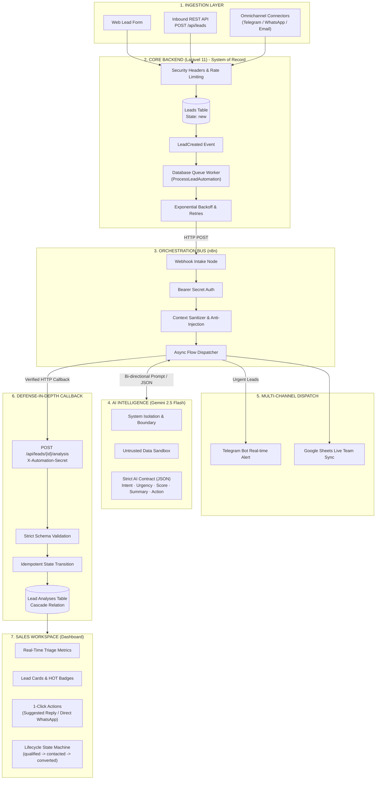

# AI-Powered Lead Operations System

<p align="center">
  
  
  
  
  
  
</p>

An event-driven, production-grade **Lead Triage & Intelligence System** designed to eliminate lead decay in B2B sales operations. It ingests unstructured inbound leads across channels, routes them through asynchronous workers and workflow orchestration, uses Google Gemini to extract structured business intelligence under a strict typed contract, and provides a centralized, actionable sales workspace.

---

## Architecture Blueprint



> **Architecture Diagram File**: The complete vector diagram is available in [`architecture-diagram.excalidraw`](./architecture-diagram.excalidraw). Open it directly in [Excalidraw](https://excalidraw.com) for a high-resolution dark-mode visual view.

---

## The Business Problem: Eliminating "Lead Decay"

In B2B services, e-commerce, and agencies:
* Inbound inquiries arrive via forms, messaging apps, and email in unstandardized, conversational text.
* Sales reps spend hours manually reading, classifying, and researching each inquiry.
* **Lead Decay**: Harvard Business Review research shows that delaying outreach past 15 minutes decreases deal qualification rates by over 80%.
* Sales teams drown in noise, spam, and vague inquiries, often missing high-ticket buyers.

### The Solution
This platform automates the intake-to-action pipeline:
1. **Instant Normalization**: Ingests unstructured Arabic/English customer text.
2. **Deterministic Triage**: Gemini extracts intent, calculates a quantitative `lead_score` (0–100), tags urgency (`low`, `medium`, `high`), and produces an executive summary and sales next step.
3. **Real-time Alerting**: High-priority opportunities instantly trigger Telegram alerts to supervisors.
4. **Actionable Sales Workspace**: Reps open the lead card, view the intelligence brief, copy pre-drafted replies, or open direct WhatsApp conversations in a single click.

---

## Architectural Principles & Separation of Concerns

Rather than tightly coupling AI directly inside synchronous controllers or offloading the entire business logic into brittle no-code tools, the system enforces a strict **three-tier boundary**:

| Component | Responsibility | Technology |
| :--- | :--- | :--- |
| **System of Record** | Single source of truth for business state, auth, rate limiting, and persistent storage. | **Laravel 11** |
| **Integration Bus** | Asynchronous orchestration, external service connectivity, and retry routing. | **n8n** |
| **Reasoning Engine** | Language understanding, intent classification, and structured scoring under contract. | **Google Gemini 2.5 Flash** |

### Defense-in-Depth AI Contract
We never treat LLM outputs as trusted data:
1. **System Prompt Isolation**: Customer messages are isolated within untrusted boundaries to neutralize Prompt Injection attacks.
2. **Strict JSON Schema**: Gemini must return a validated JSON payload matching our domain contract.
3. **Backend Schema Validation**: Laravel validates all callback fields (`intent`, `urgency`, `lead_score` between 0–100) using `FormRequest` validation before writing to MySQL.
4. **State Machine Protection**: Callbacks will never overwrite or downgrade a lead that a sales rep has already moved to `contacted` or `converted`.

---

## Key Features

### 1. Inbound Ingestion & Validation
- **Public REST API** (`POST /api/leads`): Validates contact channels (email/phone required), message length (max 5,000 characters to prevent token bombing), and channel source.
- **Enterprise Web Lead Form**: Minimalist, professional form for customer inquiries (zero emojis, clean typography).

### 2. Event-Driven Background Automation
- Native Laravel Events (`LeadCreated`) dispatched on creation.
- Queued worker (`ProcessLeadAutomation`) handles outbound HTTP dispatch to n8n with:
  - **Retries**: 3 attempts with exponential backoff (`[10s, 30s, 60s]`).
  - **Idempotency Guard**: Rejects duplicate execution if already marked `processed`.
  - **Audit Logging**: Full error tracking via `automation_error` and `automation_attempts`.

### 3. n8n Orchestrator Workflow
- Webhook intake authenticated via shared secret (`X-Automation-Secret`).
- Context builder separating prompt rules from user content.
- Multi-branch dispatching:
  - High-urgency alert pushed to **Telegram Bot**.
  - Append row to **Google Sheets** for shared reporting.
  - Callback to Laravel API to store structured intelligence.
  - Fail-safe error handling (`onError: continueRegularOutput`) to ensure downstream steps execute even if notification nodes fail.

### 4. Sales Workspace Dashboard
- Enterprise-styled supervisor dashboard built with Tailwind CSS.
- Real-time aggregate metric counters (Total Leads, AI Processed, High-Priority HOT, In-Progress).
- Triage priority filters: All, HOT (`score >= 80`), Medium (`50 <= score < 80`), Low Inquiry (`score < 50`), and Pending Analysis.
- Lead detail cards displaying:
  - Raw customer inquiry with contact metadata.
  - Dynamic urgency badge and visual score progress indicator.
  - AI Executive Briefing & Recommended Operational Action.
  - State updater dropdown (`new`, `qualified`, `contacted`, `converted`, `lost`).
  - Manual retry trigger for failed automation jobs.

### 5. Production Security Hardening
- **Security Headers Middleware**: Enforces `X-Frame-Options: DENY`, `X-Content-Type-Options: nosniff`, `X-XSS-Protection`, `Referrer-Policy`, and strict `Permissions-Policy`.
- **Intelligent Rate Limiting**: Dedicated rate limits on lead intake (`15 req/min`), callbacks, and manual retries (`20 req/min`).
- **Input Sanitization**: XSS defense and length bounds.

---

## Technical Stack

* **Framework**: [Laravel 11.x](https://laravel.com)
* **PHP**: 8.3+
* **Database**: MySQL / MariaDB (Local Herd development)
* **Testing**: [Pest PHP 3.x](https://pestphp.com)
* **Workflow Automation**: [n8n](https://n8n.io) (Docker-hosted on port 80)
* **LLM Engine**: Google Gemini 2.5 Flash via REST API
* **Frontend**: Blade, Tailwind CSS, Alpine.js
* **Local Server**: Laravel Herd (Windows)

---

## Getting Started

### Prerequisites
* [Laravel Herd](https://herd.laravel.com) or PHP 8.3+ with Composer
* [Docker Desktop](https://www.docker.com) (for running n8n container)
* MySQL database server
* Google Gemini API Key

### 1. Clone & Install Dependencies
```bash
git clone https://github.com/<your-username>/ai-lead-triage.git
cd ai-lead-triage

composer install
```

### 2. Environment Configuration
Copy `.env.example` to `.env`:
```bash
cp .env.example .env
php artisan key:generate
```

Configure your database and automation credentials in `.env`:
```env
APP_NAME="AI Lead Triage"
APP_URL=http://ai-lead-triage.test

DB_CONNECTION=mysql
DB_HOST=127.0.0.1
DB_PORT=3306
DB_DATABASE=ai_lead_triage
DB_USERNAME=root
DB_PASSWORD=

# Automation & n8n Integration
N8N_WEBHOOK_URL=http://localhost/webhook/lead-triage
AUTOMATION_SECRET=your_secure_shared_secret_here

# Queue Configuration
QUEUE_CONNECTION=database
```

### 3. Run Migrations
```bash
php artisan migrate
```

### 4. Run Background Queue Worker
```bash
php artisan queue:work --tries=3 --backoff=10,30,60
```

### 5. Run n8n in Docker
Run the pre-configured n8n container:
```bash
docker run -d --name n8n-container -p 80:5678 -v n8n_data:/home/node/.n8n docker.n8n.io/n8nio/n8n
```

> **Networking Note (Docker to Herd)**: When n8n makes callbacks back to Laravel Herd on Windows, route through `http://host.docker.internal` with the HTTP header `Host: ai-lead-triage.test`.

---

## Automated Test Suite

The project includes an automated test suite with **28 tests and 114 assertions** built on Pest PHP covering:
* Lead intake validation and defaults.
* Queue dispatching and idempotency guards.
* Security headers, rate limiting, and XSS sanitization.
* State protection preventing retro-active demotion of converted leads.
* Web dashboard rendering and supervisor status transitions.

Run the test suite:
```bash
php ./vendor/bin/pest
```

Example test output:
```text
  PASS  Tests\Unit\ExampleTest
  ✓ that true is true

  PASS  Tests\Feature\LeadAnalysisTest
  ✓ it stores lead analysis successfully and updates lead status to qualified
  ✓ it rejects lead analysis request without valid automation secret
  ✓ it validates analysis payload properly
  ✓ it allows retrieving a lead with its analysis

  PASS  Tests\Feature\LeadAutomationTest
  ✓ it dispatches LeadCreated event when lead is created via API
  ✓ it dispatches ProcessLeadAutomation job from DispatchLeadAutomation listener
  ✓ ProcessLeadAutomation job successfully sends lead to n8n and updates status to processed
  ✓ ProcessLeadAutomation prevents duplicate execution if already processed
  ✓ ProcessLeadAutomation marks automation_status as failed upon permanent failure
  ✓ N8nLeadAutomationService throws exception when webhook url is missing

  PASS  Tests\Feature\LeadCreationTest
  ✓ it creates a lead successfully with full details
  ✓ it creates a lead with minimal details and applies defaults
  ✓ it validates that message is required and at least 5 characters
  ✓ it validates allowed source values
  ✓ lead and lead analysis relationship operates correctly with cascade delete

  PASS  Tests\Feature\LeadWebPagesTest
  ✓ it renders the customer submission page successfully
  ✓ it renders the supervisor dashboard with leads and metrics
  ✓ it allows supervisor to update lead status from dashboard
  ✓ it handles customer lead submission via web POST request
  ✓ it allows supervisor to manually retry lead automation

  PASS  Tests\Feature\SecurityAndHardeningTest
  ✓ security headers are present on all web and api responses
  ✓ rate limiting throttles abusive lead submissions
  ✓ input validation rejects token bombing and oversized payloads
  ✓ it handles potential XSS payloads safely without corrupting data
  ✓ analysis callback does not demote contacted or converted leads back to qualified
  ✓ it rejects unauthorized or forged callback requests

  Tests:    28 passed (114 assertions)
  Duration: 1.15s
```

---

## API Documentation

### 1. Ingest Inbound Lead
`POST /api/leads`

**Payload:**
```json
{
  "name": "Sarah Connor",
  "email": "sarah@cyberdyne.io",
  "phone": "+14155552671",
  "company": "Cyberdyne Systems",
  "message": "We need an urgent security audit for our core customer database due to a suspected anomaly.",
  "source": "website"
}
```

**Response (`201 Created`):**
```json
{
  "message": "Lead received successfully and queued for AI analysis.",
  "data": {
    "id": 16,
    "name": "Sarah Connor",
    "status": "new",
    "automation_status": "pending",
    "created_at": "2026-10-01T14:30:00.000000Z"
  }
}
```

### 2. Store Analysis Callback
`POST /api/leads/{id}/analysis`

**Headers:**
```http
X-Automation-Secret: <your_secure_shared_secret>
Content-Type: application/json
```

**Payload:**
```json
{
  "intent": "security_audit",
  "urgency": "high",
  "lead_score": 92,
  "confidence": 0.95,
  "summary": "Customer reports a suspected anomaly and requests an urgent security audit for their database.",
  "recommended_action": "Contact immediately and dispatch senior security engineer."
}
```

**Response (`201 Created`):**
```json
{
  "message": "Lead analysis recorded successfully.",
  "data": {
    "lead_id": 16,
    "intent": "security_audit",
    "urgency": "high",
    "lead_score": 92,
    "confidence": 0.95
  }
}
```

---

## Future Roadmap

- [ ] **Omnichannel WhatsApp & Telegram Triggers**: Direct webhook connectors to Meta Cloud API and Telegram Bot API.
- [ ] **AI Suggested Reply Generation**: Dynamic 1-click Arabic/English response generator tailored to customer urgency.
- [ ] **Lead Activity Trail**: Lightweight timeline logging every human and automated interaction.
- [ ] **Multi-Tenant SaaS Partitioning**: Support for multiple isolated business workspaces.

---

## License

This project is open-source software licensed under the [MIT License](LICENSE).
